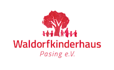
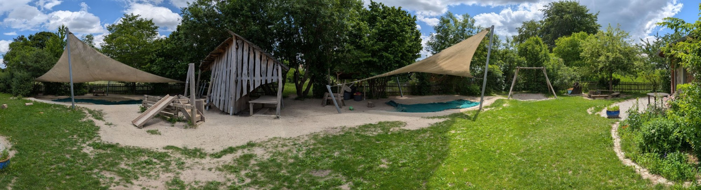

  

<h1 align="center">Raum zum Spielen. Zeit zum Wachsen.</h1>

  Natur erleben · Geborgenheit finden · Gemeinsam gestalten 
  <strong>Waldorfkinderhaus Pasing e. V. · München</strong>

  <a href="https://www.waldorfkinderhaus-pasing.de/">Unser Kinderhaus</a> &nbsp;·&nbsp;
  <a href="https://www.waldorfkinderhaus-pasing.de/anmeldung/">Anmeldung</a> &nbsp;·&nbsp;
  <a href="https://www.waldorfkinderhaus-pasing.de/kontakt/">Kontakt</a>

## Willkommen bei uns

In unserem Holzhaus in München-Pasing begleiten wir Kinder von 15 Monaten bis zum Schuleintritt. Waldorfpädagogik, freies Spiel und ein verlässlicher Tagesrhythmus prägen unseren Alltag – drinnen in liebevoll gestalteten Räumen und draußen in unserem naturbelassenen Garten.

| Natur erleben | Geborgen aufwachsen | Gemeinschaft leben |
| :--- | :--- | :--- |
| Mit natürlichen Materialien spielen, den Garten entdecken und die Jahreszeiten feiern. | In Kleinkind- und Kindergartengruppen mit vertrauten Abläufen und Raum für die eigene Entwicklung. | Eltern und pädagogisches Team gestalten das Kinderhaus gemeinsam – mit Zeit, Ideen und helfenden Händen. |

## Unser Kinderhaus auf GitHub

Willkommen im GitHub-Bereich unseres Vereins. Informationen zum pädagogischen Konzept, zur Anmeldung und zum Kinderhausalltag findet ihr auf unserer [Website](https://www.waldorfkinderhaus-pasing.de/).

[Mitwirken](https://github.com/Waldorfkinderhaus-Pasing-eV/.github/blob/main/CONTRIBUTING.md) · [Rechte und Nutzung](https://github.com/Waldorfkinderhaus-Pasing-eV/.github/blob/main/LICENSE.md)

Eigene Vereinsinhalte: alle Rechte vorbehalten. Open Source nur bei ausdrücklicher Lizenzierung.

## Besucht uns

**Waldorfkinderhaus Pasing e. V.** 
Lobelienweg 41 · 80689 München

[Kontakt aufnehmen](https://www.waldorfkinderhaus-pasing.de/kontakt/) · [Einblicke auf Instagram](https://www.instagram.com/waldorfkinderhaus_pasing/)

---

  Mit Kopf, Herz und Händen – gemeinsam für unsere Kinder.

